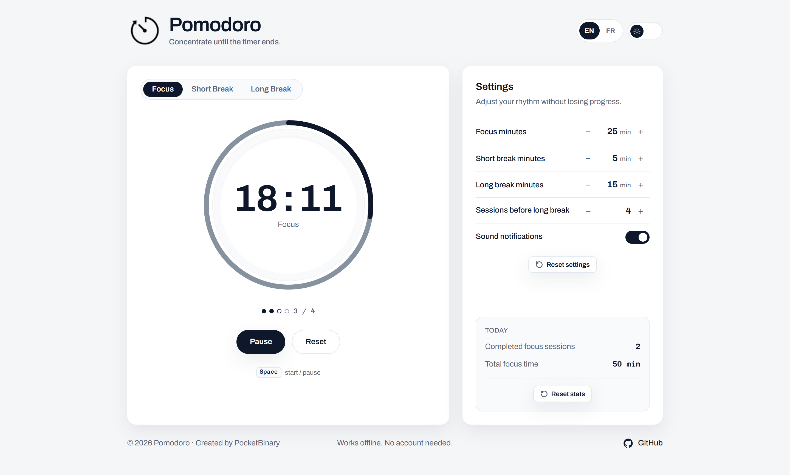
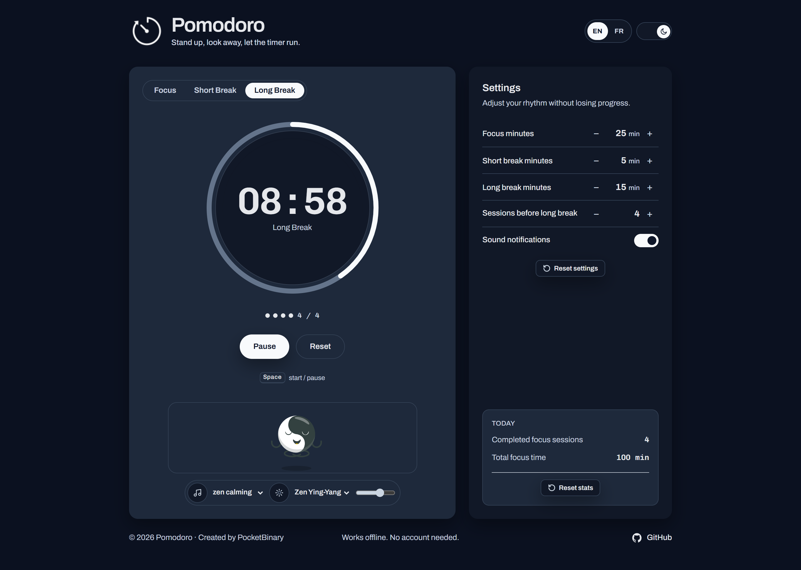
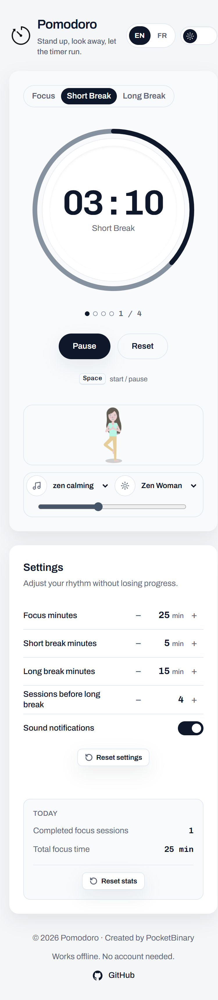

<div align="center">
  <div>
    <table style="display: flex; justify-content: center; align-items: center;">
      <tr>
        <td></td>
        <td><h1>Pomodoro</h1></td>
      </tr>
    </table>
  </div>
  <p><strong>Minuteur Focus Simple</strong> — Reste concentré, mesure tes progrès, accomplis tes objectifs.</p>
  <p><a href="README.md">Read documentation in English</a></p>
  <br />

  <!-- Ligne de badges -->
  [](#)
  [](#)
  [](#)
  [](#)
  
  <br /><br />

  [](LICENSE)
  [](#)
  
  <br />
  <br />
  <a href="https://pocketbinary.github.io/pomodoro/" rel="nofollow">
    
  </a>
</div>

<br />
<br />

---

## Fonctionnalités

<div align="center">

| Focus | Pauses & Musique | Statistiques | Carillon Audio | Notifications |
| :---: | :--------------: | :----------: | :------------: | :-----------: |
| Sessions personnalisables | 5 pistes zen + 4 visuels SVG | Compteur + temps total | Synthèse native Web Audio | Navigateur opt-in |

</div>

- **Minuteur Pomodoro 3 modes** : Focus (travail), Pause courte et Pause longue avec cycles paramétrables.
- **Lecteur d'ambiance relaxant pour les pauses** : 5 musiques zen douces (`.mp3`) et 4 animations vectorielles méditatives (`.svg`), automatiquement synchronisées avec le démarrage et la mise en pause du chrono.
- **Boutons de réinitialisation dédiés** :
  - **Réinitialisation du minuteur** : Remet à zéro uniquement le compte à rebours actif, sans toucher aux statistiques de la journée ni changer de mode.
  - **Réinitialisation des réglages** : Rétablit les durées par défaut (`25 / 5 / 15 / 4`) et active le son, protégée par une boîte de dialogue modale de confirmation.
  - **Réinitialisation des statistiques du jour** : Remet à zéro les sessions accomplies et les minutes de concentration, avec boîte de dialogue et **notification Toast avec bouton d'annulation (Undo)**.
- **Optimisation tablette en mode paysage** : Mise en page responsive sur 2 colonnes sans défilement vertical inutile, orientation déverrouillée dans le manifest PWA, et bandeau discret recommandant le mode paysage si la tablette est tenue à la verticale.
- **Sauvegarde automatique et résiliente** : Persistance dans le `localStorage` avec validation stricte du schéma de données ; reprise fluide après veille ou rechargement d'onglet.
- **Thèmes clair et sombre harmonisés** : Prise en charge intégrale du mode sombre (y compris le sélecteur audio et ses menus déroulants) sur tous les systèmes d'exploitation.
- **Interface bilingue instantanée** : Bascule immédiate Français / Anglais sans rechargement de page.
- **Progressive Web App (PWA)** : Installable sur smartphone, tablette et ordinateur comme une application native, propulsée par un Service Worker robuste (`pomodoro-cache-v12`) pour un usage 100 % hors-ligne.
- **Accessible (WCAG 2.1 AA)** : Navigation clavier complète (pattern tablist WAI-ARIA, raccourci <kbd>Espace</kbd>), annonces vocales en direct pour les lecteurs d'écran, et respect des préférences de mouvements réduits (`prefers-reduced-motion`).
- **Optimisé SEO** : Balises Open Graph, Twitter Cards, métadonnées JSON-LD Schema.org, robots.txt et plan de site sitemap.xml.

<br />

---

## Démo en direct

**[Découvrir l'application en ligne sur GitHub Pages](https://pocketbinary.github.io/pomodoro/)**

<br />

---

## Captures d'écran

<div align="center">

<table>
  <tr>
    <td align="center">
      
    </td>
    <td align="center">
      
    </td>
  </tr>
  <tr>
    <td align="center"><sub>Session de focus — thème clair</sub></td>
    <td align="center"><sub>Pause longue avec médias d'ambiance — thème sombre</sub></td>
  </tr>
</table>

<br />


<br />
<sub>Mobile — pause courte avec choix de l'animation</sub>

</div>

<br />

---

## Structure moderne du projet

Organisé selon les normes actuelles d'architecture pour les applications statiques PWA :

```text
pomodoro/
├── index.html              # Page principale en HTML5 sémantique et accessible
├── 404.html                # Page d'erreur 404 personnalisée pour GitHub Pages
├── manifest.json           # Manifest PWA pour l'installation sur appareil
├── sw.js                   # Service Worker (Cache-First assets & Network-First HTML)
├── robots.txt              # Directives d'indexation pour les moteurs et agents IA
├── sitemap.xml             # Plan de site XML pour le référencement SEO
├── llms.txt                # Contexte structuré pour agents IA & LLMs (llmstxt.org)
├── LICENSE                 # Licence open-source MIT
├── README.md               # Documentation en anglais
├── README_FR.md            # Documentation en français
├── .nojekyll               # Désactive le traitement Jekyll de GitHub Pages
├── .gitignore              # Exclut l'outillage local, les artefacts macOS et Windows
│
├── screenshots/            # Captures d'écran du README (desktop clair/sombre, mobile)
│   ├── 01-focus-light.png
│   ├── 02-break-dark.png
│   └── 03-mobile-light.png
│
├── .well-known/            # Déclarations standardisées de sécurité web
│   └── security.txt        # Déclaration de sécurité conforme au RFC 9116
│
├── css/                    # Architecture des feuilles de style
│   ├── tailwind.min.css    # Bundle Tailwind CSS autonome et minifié (zéro CDN externe)
│   └── style.css           # Tokens de design, thèmes clair/sombre, composants, tablette
│
├── js/                     # Scripts applicatifs modulaires commentés en français
│   ├── app.js              # Moteur du minuteur, persistance, synthèse audio, accessibilité
│   └── break-media.js      # Lecteur de musique ambiante et animations SVG de pause
│
├── fonts/                  # Polices web locales auto-hébergées (respect CSP & hors-ligne)
│   ├── archivo-latin.woff2
│   ├── archivo-latin-ext.woff2
│   ├── chivo-mono-latin.woff2
│   └── chivo-mono-latin-ext.woff2
│
├── icons/                  # Icônes de l'application et de la PWA
│   ├── pomodoro.png        # Favicon et logo officiel
│   ├── pomodoro-192.png    # Icône PWA 192x192 pour écran d'accueil
│   └── pomodoro-512.png    # Icône PWA 512x512 pour écran de démarrage
│
└── media/                  # Médias zen pour les temps de pause
    ├── media.json          # Index des pistes audio et animations vectorielles
    ├── README.md           # Documentation des médias de pause
    ├── zen calming.mp3
    ├── zen garden.mp3
    ├── zen music 01.mp3
    ├── zen music 02.mp3
    ├── zen piano.mp3
    ├── Zen Ying-Yang.svg
    ├── Zen Man.svg
    ├── Zen Nenuphar.svg
    └── Zen Woman.svg
```

### Architecture technique

| Domaine | Implémentation |
| ------- | -------------- |
| **Framework** | Aucun — HTML5, CSS3 et JavaScript ES6+ Vanilla |
| **Styles** | Tailwind CSS autonome compilé (`css/tailwind.min.css`, zéro CDN) + tokens CSS personnalisés dans `css/style.css` |
| **État** | `localStorage` avec validation de schéma JSON et repli automatique sain |
| **Audio** | Synthèse native par oscillateurs sinusoïdaux (Web Audio API) + Audio HTML5 |
| **Hors-ligne & PWA** | Service Worker (`Cache-First` pour les assets, `Network-First` pour le HTML) |
| **Accessibilité** | Pattern tablist WAI-ARIA, modale `<dialog>`, zones live, WCAG 2.1 AA |

<br />

---

## Installation et lancement local

### Développement en local

Aucune étape de compilation ni bundler n'est requis. Servez simplement le dossier avec n'importe quel serveur HTTP statique :

```bash
# Avec npx serve
npx serve . -l 3000

# Ou avec Python 3
python -m http.server 3000
```

Accédez à l'application dans votre navigateur sur `http://localhost:3000`.

### Raccourcis clavier

- <kbd>Espace</kbd> : Démarrer / Mettre en pause (accessible depuis toute l'interface).
- <kbd>←</kbd> / <kbd>→</kbd> ou <kbd>↑</kbd> / <kbd>↓</kbd> : Naviguer entre les modes (Focus, Pause courte, Pause longue).
- <kbd>Début (Home)</kbd> / <kbd>Fin (End)</kbd> : Aller au premier ou au dernier mode.
- <kbd>Tab</kbd> / <kbd>Maj + Tab</kbd> : Parcourir les réglages, steppers et boutons.

<br />

---

## Licence

Ce projet est sous licence open-source [MIT](LICENSE).
